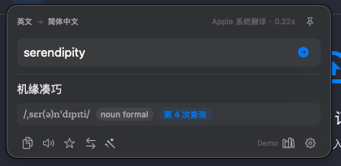

# 捕词 · Catchword

> 选中的词，捕进来就别跑了。

macOS 原生取词翻译工具。选中文字按 `⌃⌘T` 直接出译文——走系统「服务」通道，**不需要任何安全授权**。查过的词自动进词库，按查询频次排序，越查越懂你。

参考 [EchoLingo](https://github.com/Blueeeecho/EchoLingo) 的产品形态，但用 **纯 Swift（AppKit + SwiftUI）** 重写，不套 Tauri/Electron，无 WebView、无 Node、无 Python 运行时。

<p align="center">
  
</p>

---

## 特性

| | |
|---|---|
| **原生轻量** | 通用二进制 5.1 MB（arm64 + x86_64），常驻内存约 75–95 MB、CPU 0%、无后台轮询、无定时器 |
| **兼容老系统** | 部署目标 **macOS 12**，Intel 与 Apple Silicon 都能跑 |
| **系统翻译** | macOS 15+ 直接调 `Translation.framework`（和「翻译.app」同一套端上模型），离线互译，零 token |
| **本机词典** | 任何系统都能离线查「词典.app」的词库（新系统自带牛津英汉汉英），单词级中英互译 |
| **任意大模型** | 兼容 OpenAI `/chat/completions` 协议，支持 SSE 流式输出：DeepSeek、通义、Kimi、Ollama、LM Studio、OneAPI… |
| **自动降级** | 系统翻译不可用时自动依次退到本机词典 → 大模型，并在浮窗提示 |
| **词库** | 单词自动收录、频次累加、SM-2 间隔复习、CSV/Anki 导出 |
| **取词（主路径）** | 选中文字按 `⌃⌘T` 出译文 —— 走系统 `NSServices`，系统把选区递过来，**零权限、零配置、不动剪贴板** |
| **取词（自动气泡）** | 拖选松手弹小圆点、双击单词直接出译文。这条要读别的 App 的 AX，需系统级授权，默认不申请，见下方说明 |
| **取词兜底** | `⌘C` 复制即译、右键 › 服务 › 用捕词翻译、`⌥D` 全局热键 —— 都不需要授权 |
| **隐私** | 密钥存钥匙串，数据存本地 SQLite，无遥测；只有你选了云端服务才会把文字发给你自己配置的接口 |

## 下载安装（不用编译）

到 [Releases](https://github.com/SingleTime/catchword/releases/latest) 下载 `Catchword-1.1.0-macOS-universal.zip`（arm64 + x86_64 通用包，约 2 MB），解压后把「捕词.app」拖进「应用程序」。

**首次打开会被 Gatekeeper 拦住**——这个包是 ad-hoc 签名，没有 Apple 开发者证书、也没做公证。这是正常现象，三选一即可，之后不再提示：

| 方式 | 具体操作 |
|---|---|
| **右键打开**（最省事） | Finder 里右键点「捕词」→「打开」→ 弹窗里再点一次「打开」 |
| **系统设置**（弹窗只给「移到废纸篓」时用这个） | 先去 系统设置 › 隐私与安全性，往下翻到「已阻止使用捕词」，点「仍要打开」，输密码确认 |
| **命令行**（最干脆） | `xattr -dr com.apple.quarantine /Applications/捕词.app` |

> 为什么会拦：macOS 会给下载来的文件打上 `com.apple.quarantine` 标记，带标记且没有公证签名就会被 Gatekeeper 拒。去掉标记后，ad-hoc 签名的 App 能正常启动。自己按下面方式编译出来的包没有这个标记，压根不会提示。

## 构建

要求 **macOS 12+** 与 Xcode 命令行工具（Swift 6）。默认打通用二进制，Intel 与 Apple Silicon 通用。

```bash
./build.sh              # 产出 dist/捕词.app（arm64 + x86_64）
./build.sh --install    # 额外装到 ~/Applications
./build.sh --run        # 装完直接启动
ARCHS=arm64 ./build.sh  # 只编当前架构，调试更快
```

也可以直接用 Xcode 打开 `Package.swift` 开发调试。

## 首次使用

1. 启动后菜单栏出现「捕词」取景框图标。首次启动会自动把 `⌃⌘T` 挂到系统「服务」上。
2. **主用法**：在任意 App 里选中文字 → 按 `⌃⌘T` → 直接出译文。
   走的是系统「服务」通道，系统自己把选中内容递过来，不需要任何权限。
   键位可在 系统设置 › 键盘 › 键盘快捷键 › 服务 › 用捕词翻译 里改。
3. **顺手用法**：选中文字按 `⌘C`，选区旁边冒「译」小圆点，点开就是译文——你本来就要复制，等于白送。
4. **兜底**：`⌥D` 唤起面板；面板里也能直接敲字，`Enter` 翻译。
5. **想要「不按键就自动弹」**：那是「划词自动气泡」，需要系统级授权。
   代价见下方「关于系统级授权」——**不建议为了它去授权**，`⌃⌘T` 已经够快。

> 复制即译靠轮询 `NSPasteboard.changeCount`（0.4 秒一次，只读一个整数），零权限、零副作用。
> 想在 IDE 里关掉它，可在 设置 › 通用 关掉「复制即译」。

> **关于系统级授权**：macOS 26 起，Apple 把「辅助功能 + 全盘访问 + 屏幕录制 + 键击监控」合并成一张
> **System & App Protection Override** 总授权表。勾了它，App 就能读你所有磁盘文件、所有照片、浏览历史、
> 每一次键击。捕词用不到这些，所以**默认不申请**。
> 只在你有明确需要时才去 系统设置 › 隐私与安全 › System & App Protection Override 手动添加，
> 加完重启捕词。另外 ad-hoc 签名每次重新编译都会变，重新编译后这类授权得重新给一次。

## 快捷键

| 操作 | 默认触发 |
|---|---|
| 选中即译 | 选中文字按 `⌃⌘T`（**不需要权限**，走系统服务） |
| 复制即译 | 选中文字按 `⌘C`（**不需要权限**） |
| 服务菜单 | 右键 › 服务 › 用捕词翻译（**不需要权限**） |
| 唤起面板 | `⌥D`（Option + D，**不需要权限**；有授权时会顺手读走选中文字） |
| 拖选文字 | 选区旁出小圆点（**需系统级授权**，默认不启用） |
| 双击单词 | 直接展开译文（**需系统级授权**，默认不启用） |
| 翻译 | `Enter` |
| 换行 | `Shift + Enter` |
| 关闭浮窗 | `Esc` 或点击外部（钉住后不关） |
| 浮窗内编辑 | `⌘C` / `⌘V` / `⌘A` / `⌘Z` 均可用 |

`⌃⌘T` 在系统设置里改；`⌥D` 可在 设置 › 通用 里重录。

## 配置翻译服务

设置 › 翻译服务，默认三个：

- **Apple 系统翻译** —— 无需配置，但**需要 macOS 15+**。若提示缺少语言包：系统设置 › 通用 › 语言与地区 › 翻译语言，下载「中文 ↔ 英文」。
- **系统词典（离线）** —— 无需配置，任何系统版本都能用。走 `DictionaryServices` 查本机「词典.app」的词库，新系统自带牛津英汉汉英，单词级中英互译，不发网络请求。
- **OpenAI 兼容接口** —— 填 接口地址 / 模型 / API Key：

| 服务 | Base URL | 模型示例 |
|---|---|---|
| OpenAI | `https://api.openai.com/v1` | `gpt-4o-mini` |
| DeepSeek | `https://api.deepseek.com/v1` | `deepseek-chat` |
| 阿里百炼 | `https://dashscope.aliyuncs.com/compatible-mode/v1` | `qwen-plus` |
| 本地 Ollama | `http://127.0.0.1:11434/v1` | `qwen2.5:7b` |
| LM Studio | `http://127.0.0.1:1234/v1` | 任意已加载模型 |

填完点「测试连接」。单词查询开启后走词典模式，返回音标 / 词性 / 例句（JSON 结构化解析，失败自动降级纯文本）。

## 词库怎么长出来的

- 只对**单个单词**自动收录（短语和整句只进查询日志，不污染词库）。
- 同一个词反复查 → `lookup_count` 累加，浮窗显示「第 N 次查询」。
- 词库窗口可按**高频优先**排序，直接看出你真正卡在哪些词上。
- 复习用简化 SM-2：忘了（10 分钟后重来）/ 模糊（间隔 ×1.3）/ 记得（间隔 × ease）。
- 导出 CSV 或 Anki 可导入的 TSV。

## 数据位置

```
~/Library/Application Support/Catchword/
├── catchword.sqlite     # 词库 + 查询日志
└── settings.json        # 配置（不含密钥）
```

密钥在钥匙串：service `com.fw.catchword`。

## 结构

```
Sources/Catchword/
├── App/          启动、菜单栏、窗口管理、开机自启
├── Capture/      Carbon 全局热键、CGEventTap 划词监听 + 小气泡、AX 取词 + ⌘C 兜底
├── Translation/  Apple 翻译、OpenAI 流式、调度与缓存
├── Storage/      SQLite 封装、词库与复习、钥匙串
├── Model/        设置模型与持久化
└── UI/           浮窗、设置、词库
```

## 调试

```bash
open dist/捕词.app --args --demo      # 直接弹一个示例浮窗（跳过取词）
open dist/捕词.app --args --settings  # 启动即打开设置
open dist/捕词.app --args --vocab     # 启动即打开词库
open dist/捕词.app --args --selftest-trigger   # 打印划词监听状态并试弹一次气泡
```

## 版本与系统支持

| macOS | 系统翻译 | 本机词典 | 大模型 |
|---|---|---|---|
| 12 – 14 | ✗（系统里根本没有机器翻译引擎） | ✓ | ✓ |
| 15 – 25 | ✓（靠隐藏 SwiftUI 宿主取 session） | ✓ | ✓ |
| 26+ | ✓（有直连 API） | ✓ | ✓ |

12–14 上不需要额外配置：单词自动落到本机词典，整句请配一个大模型服务（本机 Ollama / LM Studio 也算）。

### 15–25 是怎么调通系统翻译的

`TranslationSession` 没有公开的无参初始化方法：`TranslationSession(installedSource:target:)` 要 macOS 26，
macOS 15 只肯通过 SwiftUI 的 `.translationTask` 把 session 递进来。所以启动时挂一个 1×1 全透明的隐藏窗口，
里面放一个只有 `Color.clear` 的宿主视图接住 session，外部请求排队喂给它，`translate` 始终在修饰符的
action 闭包里串行执行（闭包一返回 session 就会被回收）。

两个实测坑：

- **源语言必须显式传。** 交给系统自动识别（`source: nil`）时，单个单词会因为语言置信度不足**一直挂着不返回**，整句正常。所以先用 NLD 检测出源语言再传进去。
- **隐藏窗口必须真的 `orderFrontRegardless()`**，只创建不进场的话 SwiftUI 不会跑 `translationTask`；`alphaValue = 0` 全透明不影响引擎工作。

## 已知限制

- 系统翻译要求 macOS 15+；语言对取决于本机已下载的语言包。
- 本机词典只处理单词，且查中文词时若只有汉语词典释义（没有英文对译）会判定为未命中，转而请求大模型。
- 未做 Developer ID 签名与公证，下载的包首次打开要过一次 Gatekeeper（见「下载安装」）。
- ad-hoc 签名下**自己重新编译**会生成新的签名值，系统会当成另一个程序，已给出的系统级授权要重新给一次。
- 划词自动气泡需要系统级授权。macOS 26 起那是一条 **System & App Protection Override** 总授权（辅助功能 + 全盘访问 + 屏幕录制 + 键击监控合并），代价与收益不成比例，所以主路径改成 `⌃⌘T` 系统服务，功能一样完整、一点授权都不用给。
- 用 ⌘C 兜底取词时，会短暂占用剪贴板（随后恢复原内容）；个别 App 的富文本格式可能无法 100% 还原。
- 划词的定位靠 `kAXBoundsForRangeParameterizedAttribute`，Chrome / VS Code 等 Chromium 系经常不给选区矩形，此时气泡退到鼠标位置显示（不影响使用，只是位置没那么准）。
- 复制即译靠 `NSPasteboard.changeCount` 轮询（0.4 秒一次，只读一个整数），复制路径、代码块、纯数字不会触发。
- 词库只统计单词，不做短语搭配分析。

## 许可证

[MIT](LICENSE) © 2026 jiangliao

## 致谢

- 产品形态参考 [EchoLingo](https://github.com/Blueeeecho/EchoLingo)
- 图标由 `tools/make-icon.swift` 用 CoreGraphics 直接绘制，无外部素材

